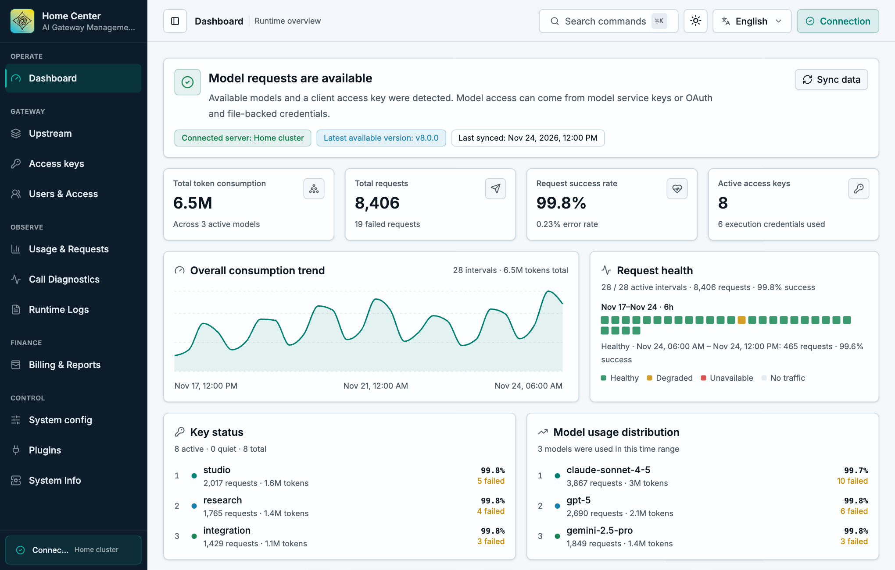
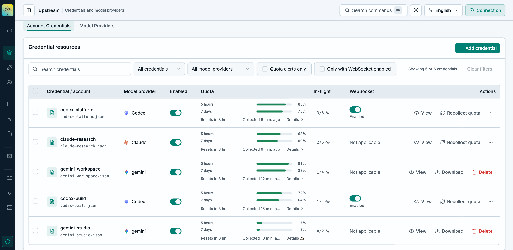
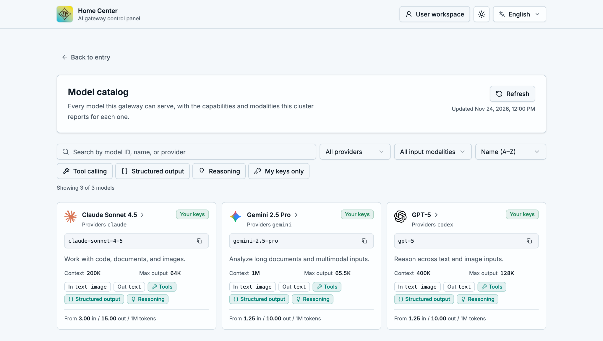

<div align="center">


# Home Management Center

**The admin console and user workspace for CLIProxyAPIHome**

Operators manage upstream credentials and monitor gateway traffic.<br />
Users find available models, manage their API keys, and track usage.

[](https://github.com/router-for-me/CLIProxyAPIHome#deploying-an-official-release)
[](#interface-languages)
[](LICENSE)

**English** · <a href="README_CN.md" lang="zh-CN">简体中文</a>

[Quick start](#quick-start) · [Features](#features) · [Development](#development)

</div>

---

[](docs/screenshots/dashboard-en.png)

_All screenshots use example data. Select an image to view it at full size._

## Quick start

1. Start Home using the official binary or Docker image. Both include the web console. [Install Home](https://github.com/router-for-me/CLIProxyAPIHome#deploying-an-official-release)
2. Open Home in your browser. The default local address is `http://localhost:8327`.
3. Choose the sign-in for your role.
   - **Admin sign-in** · Enter your Home management key. [`/management.html`](http://localhost:8327/management.html)
   - **User sign-in** · Sign in with your Home user account. [`/user.html`](http://localhost:8327/user.html)

> [!NOTE]
> To call a model from an application, create a **client API key** in the user workspace after signing in.

<details>
<summary>Remote access</summary>

Open the same paths at your Home server’s HTTPS address. Keep the management key private and restrict access to the management endpoint. [Home authentication settings](https://github.com/router-for-me/CLIProxyAPIHome/blob/main/docs/management/api.md#authentication)

</details>

## Features

| Area                   | What you can do                                                                               |
| ---------------------- | --------------------------------------------------------------------------------------------- |
| **Dashboard**          | Check gateway readiness, request volume, token consumption, and success rate.                 |
| **Upstream**           | Manage provider keys, add accounts via OAuth or file import, and check remaining quota.       |
| **Users & Access**     | Issue client API keys and limit their access by channel group or model group.                 |
| **Usage & Requests**   | Filter request records by provider, model, or status and inspect token usage.                 |
| **Diagnostics & logs** | Investigate failed calls, read runtime logs, and download request error logs.                 |
| **Billing & Reports**  | Set model prices, inspect individual charges, and review balance changes.                     |
| **System**             | Preview configuration changes before saving, check node status, and manage supported plugins. |
| **User workspace**     | Manage your keys, find models you can call, and review your spending and balance.             |

### Console tour

<details>
<summary><strong>Upstream → Account Credentials</strong></summary>

Read quota windows and in-flight request counts side by side for each account. Open a row to inspect its models or edit its metadata.

[](docs/screenshots/upstream-accounts-en.png)

</details>

<details>
<summary><strong>User workspace → Model catalog</strong></summary>

Search by model ID or filter by provider, input modality, or tool support. Signed-in users can compare published input and output prices for the models their keys can call.

[](docs/screenshots/model-catalog-en.png)

</details>

### Interface languages

The interface supports English, Simplified Chinese, Traditional Chinese, and Russian. Choose a language or follow the browser setting. Light and dark themes are available on desktop and mobile in Chrome, Edge, Firefox, and Safari.

## Development

Use Node.js 24 or later, Bun 1.3 or later, and a running Home instance. Start the development server from this repository.

```sh
bun install --frozen-lockfile
bun run dev
```

Open `http://localhost:3000/management.html` or `http://localhost:3000/user.html`. The development proxy points to `http://127.0.0.1:8327` by default.

| Task                  | Command                                |
| --------------------- | -------------------------------------- |
| Check types and lint  | `bun run typecheck` and `bun run lint` |
| Check formatting      | `bun run format:check`                 |
| Build and preview     | `bun run build` and `bun run preview`  |
| Build assets for Home | `bun run build:embedded`               |

The frontend uses React 19, TypeScript, TanStack Router and Query, Tailwind CSS, and Rsbuild. The project scripts also cover route generation, formatting, and unused-code checks. [Scripts and dependencies](package.json)

Home's build guide explains how to package the contents of `dist/` with the backend. [Build Home with the console](https://github.com/router-for-me/CLIProxyAPIHome#building-and-releasing-the-bundled-frontend)

For UI changes, include a screenshot and the checks you ran. For bug reports, include the Home version, browser, and steps to reproduce. [Product guide](PRODUCT.md) · [Design guide](DESIGN.md) · [Contributor instructions](AGENTS.md)

## License

[MIT](LICENSE)
