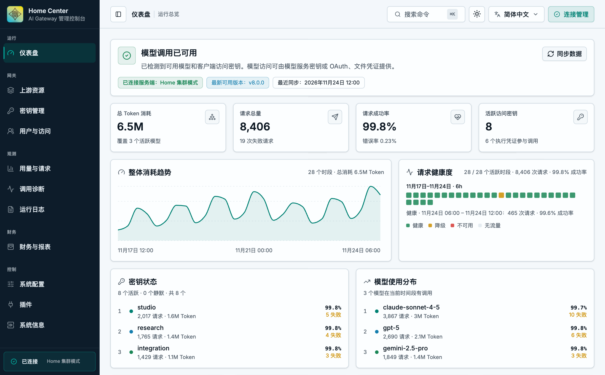
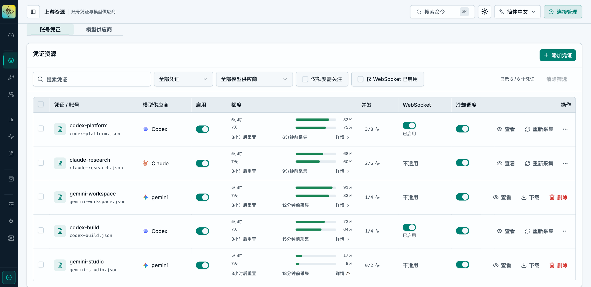

<p align="center">
  
</p>

<h1 align="center">Home Management Center</h1>

<p align="center">
  <a href="https://github.com/router-for-me/CLIProxyAPIHome">CLIProxyAPIHome</a> 的 Web 控制台。<br />
  管理员在这里管理网关和上游凭证，用户可以查找模型、管理自己的 API 密钥并查看用量。
</p>

<p align="center">
  <a href="README.md" lang="en">English</a> · <strong>简体中文</strong><br />
  <a href="#快速开始">快速开始</a> · <a href="#界面导览">界面导览</a> · <a href="#本地开发">本地开发</a>
</p>

[](docs/screenshots/dashboard-zh-CN.png)

_截图均使用示例数据，点开可查看原图。_

## 快速开始

Home 的官方二进制和 Docker 镜像都已内置这两个工作区。启动 Home 后，按身份打开对应入口。[Home 安装说明](https://github.com/router-for-me/CLIProxyAPIHome/blob/main/README_CN.md#部署正式发行版)

- **管理员控制台** · 使用 Home 管理密钥登录。<br />
  `http://localhost:8327/management.html`
- **用户工作台** · 使用自己的 Home 用户账号登录。<br />
  `http://localhost:8327/user.html`

访问远程实例时，将地址换成该实例的主机名和端口。请妥善保管管理密钥，远程管理入口应启用 HTTPS 和服务端访问控制。

## 界面导览

### 上游账号凭证

打开 **上游资源 → 账号凭证**，可以查看哪些账号已启用、各账号还剩多少额度。可通过 OAuth 或导入凭证文件添加账号，点开已有账号可查看可用模型、编辑元数据。在 **模型供应商** 标签页可管理供应商 API 密钥。

[](docs/screenshots/upstream-accounts-zh-CN.png)

### 用户模型目录

用户可以按模型 ID 搜索，也可以按供应商、输入类型或工具调用能力筛选。登录后还能查看自己的密钥可调用哪些模型，并比较已公布的输入和输出价格。

[](docs/screenshots/model-catalog-zh-CN.png)

### 管理员的其他常用操作

- **管理访问权限。** 签发客户端密钥，为用户设置访问规则。
- **排查请求故障。** 从用量记录定位失败请求，通过调用诊断或运行日志追查原因。
- **核对计费。** 设置模型价格，查看用量费用和报表。
- **调整系统配置。** 编辑网关设置，在保存前核对差异。

界面支持简体中文、繁体中文、英语和俄语，可跟随浏览器语言或手动切换。在桌面或移动设备上，可通过 Chrome、Edge、Firefox 和 Safari 使用浅色或深色主题。

## 本地开发

准备 Node.js 24 或更高版本、Bun 1.3 或更高版本，以及一个已启动的 Home 实例。在本仓库目录启动开发服务。

```sh
bun install --frozen-lockfile
bun run dev
```

打开 `http://localhost:3000/management.html` 或 `http://localhost:3000/user.html`。开发代理默认连接 `http://127.0.0.1:8327`。

| 任务                 | 命令                                  |
| -------------------- | ------------------------------------- |
| 类型检查和代码检查   | `bun run typecheck` 和 `bun run lint` |
| 检查格式             | `bun run format:check`                |
| 构建并预览           | `bun run build` 和 `bun run preview`  |
| 为 Home 构建内嵌资源 | `bun run build:embedded`              |

前端使用 React 19、TypeScript、TanStack Router 和 Query、Tailwind CSS 及 Rsbuild。仓库脚本还提供路由生成、格式化和未使用代码检查。[脚本和依赖](package.json)

如需将 `dist/` 的内容打包进后端，可参考 Home 的构建说明。[将控制台内嵌到 Home](https://github.com/router-for-me/CLIProxyAPIHome/blob/main/README_CN.md#前端内嵌构建与发布流程)

提交界面改动时，请附上截图和已运行的检查。报告问题时，请注明 Home 版本、浏览器和复现步骤。[产品说明](PRODUCT.md) · [设计规范](DESIGN.md) · [贡献指南](AGENTS.md)

## 许可证

[MIT](LICENSE)
