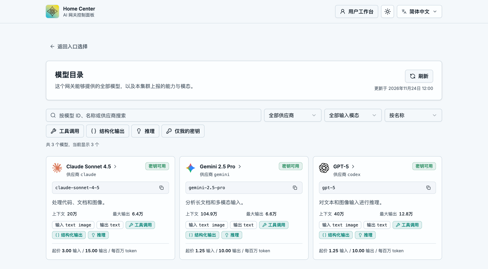

<div align="center">


# Home Management Center

**CLIProxyAPIHome 的管理控制台与用户工作台**

管理员维护上游凭证，监控网关流量。<br />
用户查找可用模型，管理自己的 API 密钥并查看用量。

[](https://github.com/router-for-me/CLIProxyAPIHome/blob/main/README_CN.md#部署正式发行版)
[](#界面语言)
[](LICENSE)

<a href="README.md" lang="en">English</a> · **简体中文**

[快速开始](#快速开始) · [功能概览](#功能概览) · [本地开发](#本地开发)

</div>

---

[](docs/screenshots/dashboard-zh-CN.png)

_截图均使用示例数据，点开可查看原图。_

## 快速开始

1. 使用 Home 官方二进制或 Docker 镜像启动服务。两者均已内置控制台。[Home 安装说明](https://github.com/router-for-me/CLIProxyAPIHome/blob/main/README_CN.md#部署正式发行版)
2. 在浏览器中打开默认本地地址 `http://localhost:8327`。
3. 选择与你身份对应的登录入口。
   - **管理员登录** · 输入 Home 管理密钥。[`/management.html`](http://localhost:8327/management.html)
   - **用户登录** · 使用自己的 Home 账号。[`/user.html`](http://localhost:8327/user.html)

> [!NOTE]
> 应用调用模型时使用**客户端 API 密钥**，可在用户工作台创建。

<details>
<summary>访问远程实例</summary>

使用 Home 服务器的 HTTPS 地址打开相同路径。请妥善保管管理密钥，并限制管理端点的访问权限。[Home 认证设置](https://github.com/router-for-me/CLIProxyAPIHome/blob/main/docs/management/api_CN.md#认证)

</details>

## 功能概览

<table>
  <thead>
    <tr><th scope="col" nowrap>控制台模块</th><th scope="col" width="100%">常用操作</th></tr>
  </thead>
  <tbody>
    <tr><th scope="row" align="left">仪表盘</th><td>确认网关能否接受模型请求，查看请求量、Token 消耗和成功率。</td></tr>
    <tr><th scope="row" align="left">上游资源</th><td>管理供应商密钥，通过 OAuth 或导入凭证文件接入账号，查看剩余额度。</td></tr>
    <tr><th scope="row" align="left">用户与访问</th><td>签发客户端 API 密钥，通过通道组和模型组限定每把密钥的访问范围。</td></tr>
    <tr><th scope="row" align="left">用量与请求</th><td>按供应商、模型或状态筛选请求记录，查看 Token 用量。</td></tr>
    <tr><th scope="row" align="left">诊断与日志</th><td>排查请求失败原因，查看运行日志，下载请求错误日志。</td></tr>
    <tr><th scope="row" align="left">财务与报表</th><td>设置模型价格，核对单笔扣款和余额变动。</td></tr>
    <tr><th scope="row" align="left">系统管理</th><td>保存前预览配置差异，查看节点状态，管理实例支持的插件。</td></tr>
    <tr><th scope="row" align="left">用户工作台</th><td>管理自己的密钥，查找可调用的模型，查看消费记录和余额。</td></tr>
  </tbody>
</table>

### 界面导览

<details>
<summary><strong>上游资源 → 账号凭证</strong></summary>

列表中可以并排查看每个账号的额度窗口和当前并发请求数。点开一行即可查看该账号的可用模型或编辑元数据。

[](docs/screenshots/upstream-accounts-zh-CN.png)

</details>

<details>
<summary><strong>用户工作台 → 模型目录</strong></summary>

按模型 ID 搜索，或按供应商、输入类型和工具调用能力筛选。登录后，可以查看自己的密钥能调用哪些模型，并比较这些模型已公布的输入和输出价格。

[](docs/screenshots/model-catalog-zh-CN.png)

</details>

### 界面语言

界面支持简体中文、繁体中文、英语和俄语，可跟随浏览器语言或手动切换。在桌面或移动设备上，可通过 Chrome、Edge、Firefox 和 Safari 使用浅色或深色主题。

## 本地开发

准备 Node.js 24 或更高版本、Bun 1.3 或更高版本，以及一个已启动的 Home 实例。在本仓库目录启动开发服务。

```sh
bun install --frozen-lockfile
bun run dev
```

打开 `http://localhost:3000/management.html` 或 `http://localhost:3000/user.html`。开发代理默认连接 `http://127.0.0.1:8327`。

| 任务                 | 命令                                  |
| -------------------- | ------------------------------------- |
| 类型检查和代码检查   | `bun run typecheck` 和 `bun run lint` |
| 检查格式             | `bun run format:check`                |
| 构建并预览           | `bun run build` 和 `bun run preview`  |
| 为 Home 构建内嵌资源 | `bun run build:embedded`              |

前端使用 React 19、TypeScript、TanStack Router 和 Query、Tailwind CSS 及 Rsbuild。仓库脚本还提供路由生成、格式化和未使用代码检查。[脚本和依赖](package.json)

如需将 `dist/` 的内容打包进后端，可参考 Home 的构建说明。[将控制台内嵌到 Home](https://github.com/router-for-me/CLIProxyAPIHome/blob/main/README_CN.md#前端内嵌构建与发布流程)

提交界面改动时，请附上截图和已运行的检查。报告问题时，请注明 Home 版本、浏览器和复现步骤。[产品说明](PRODUCT.md) · [设计规范](DESIGN.md) · [贡献指南](AGENTS.md)

## 许可证

[MIT](LICENSE)
